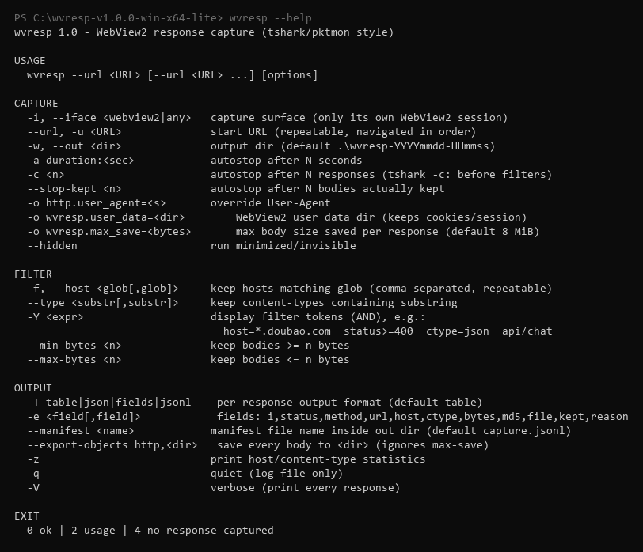

# wvresp

**会跑 JS 的 curl。** 给它一个网址，它在 WebView2 里把网页跑一遍，把页面运行期间发出去的每个 HTTP(S) 响应的**明文正文**存下来——不需要管理员，不装驱动，不装证书，不注入。

它有 `tshark` / `pktmon` 长相的命令行参数，但**它不是抓包工具的替代品**：它的对标是 `curl`。

---

## 先分清它和 curl 的差别

| | `curl` | `wvresp` |
| --- | --- | --- |
| 输入 | 一个 URL | 一个 URL（可多个） |
| 执行网页 JS | 不执行 | 执行 |
| 拿到的内容 | 你发的那一次请求的响应 | 页面运行期间自己发出的**所有**响应 |
| 登录态 | 自己拼 cookie | `-o wvresp.user_data=<目录>` 复用已有会话 |
| 签名 / 时间戳 / 设备指纹参数 | 得自己算 | 页面自己算，工具只旁观 |
| 依赖 | 一个二进制 | Windows 自带的 WebView2 运行时 |
| 权限 | 无 | 无 |
| 输出 | stdout / 单个文件 | 目录：`bodies/` + 清单 `capture.jsonl` + 日志 + 统计 |

`curl` 抓不到的那一类，正好是 `wvresp` 唯一的意义：

- 数据是 JS 运行时请求来的（列表、搜索、推荐、分页、评论区）；
- 请求要带 JS 现场算出来的签名 / 时间戳 / token；
- POST、二次跳转、流式（SSE）响应；
- 同一页面一路发出上百个请求，你只想要其中 `application/json` 的那几十个。

## 和其余几家的位置

| 工具 | 关系 | 它怎么拿数据 / 凭什么不重叠 |
| --- | --- | --- |
| `curl` | **主对标** | 不发 JS，只拿第一个响应 |
| Playwright / Puppeteer | 能力**重叠**，体积不同 | 同一招（页面响应事件），代价是 Node + 一整套浏览器（几十至几百 MB） |
| mitmproxy / Fiddler | 另一条路 | 要装根证书、改代理，程序可感知；wvresp 不碰证书 |
| tshark / dumpcap | 另一条路 | 网卡抓包 + 装 Npcap 驱动，通常要管理员 |
| pktmon | 另一条路 | 内核抓包，**必须管理员** |
| friTap / Frida | 另一条路 | 注入进程 hook TLS 导出点，要附加权限，会被反调试检测 |

一句话：**wvresp 拿的是"网页壳程序自己看到的那份数据"，而且不要权限。** 需要全机视野时，上面那几个更合适。

---

## 它是怎么做到的

网页壳程序（WebView2 外壳、Electron 壳、Edge 的网页视图）打开网页时，TLS 由引擎自己完成。宿主程序调一个官方接口，拿到的**本来就是明文**：

```csharp
wv.CoreWebView2.WebResourceResponseReceived += (s, e) => {
    // e.Response.StatusCode / Headers
    // e.Response.GetContentAsync()  →  明文 body
};
```

所以它不是"破解 TLS"，是**门本来就从里面开着**：wvresp 是宿主，把递到手上的东西接过来放进箱子。没有证书、没有密钥、没有代理、没有注入。

---

## 能力边界（重要，逐条说清）

### 1. 它能拿到的，只有本进程这个 WebView2 控件发起的请求

`WebResourceResponseReceived` 事件的触发面就是这条：**本进程、这个控件、它发出的请求**。没有这个事件，工具就没有数据来源。这不是权限不够，是采集面就在这里。

### 2. 同一个进程里，不走 WebView2 的流量也看不到

宿主自己（或同进程的原生代码）用 Schannel / WinHTTP / 自研 socket 发的请求，WebView2 不感知，wvresp 也看不到。**这是 WebView2 采集面的固有缺口**，不是可以靠参数打开的开关。

### 3. 别的进程的流量：抓不到，因为我们一条跨进程通道都没做

要拿别的进程的数据，必须有一条通道：注入 hook、调试端口（CDP）、系统代理、或者抓网卡。wvresp 这四条**一条都没有实现**，所以它拿不到——这是产品选择，不是能力不足。

这里要说得准确一点，不要含糊其辞：在 Windows 上，同用户、同完整性级别时，**附加另一个进程并不总是需要管理员**（提权进程、受保护进程才需要）。所以"别的程序抓不到"的准确理由是：

> 那需要"附加进程"这一类手段（friTap / Frida 那一路），会触发反调试与 EDR，属于我们不做的方向；**不是**说物理上一定做不到。

### 4. 它不解密，因为没有密文

TLS 在 WebView2 内部就结束了，递到宿主手上的是明文。所以它既不需要密钥，也没有"解密能力"可言。

### 5. 它拿不到你本来没权限看的东西

不能绕登录、不能绕鉴权、不能绕证书钉死。能拿到的，都是你自己这次访问本来就能看到的。

---

## 什么时候别用它

- 只想抓一个公开静态页面 → **`curl` 更快更简单**；
- 要看清一台机器上所有程序的流量 → `tshark` / `pktmon`（需要提权，但那是它们的本职）；
- 目标程序不是网页壳、网络走原生 TLS → `wvresp` 完全没用武之地；
- 需要抓 pcap 做协议分析 → 这不是这工具的产品线。

---

## 能做什么

| 能力 | 说明 |
| --- | --- |
| 顺序访问多个网址 | `-u` 可重复，按顺序打开，间隔 800 ms |
| 过滤 | 域名（`-f`，支持 `*` / `?`）、内容类型（`--type`）、显示式过滤（`-Y`：`host= url= ctype= status>=`）、字节数（`--min-bytes/--max-bytes`） |
| 落盘 | `bodies\序号_域名_文件名.扩展名`，扩展名按内容类型推 |
| 清单 | `capture.jsonl`：每个响应一行，未保存的也记，带 `reason` |
| 日志 | `wvresp.log`：导航成功/失败、取正文报错、域名与类型统计 |
| 统计 | `-z`：访问最多的域名（带已存字节）+ 内容类型分布 |
| 字段输出 | `-e i,status,url,bytes,md5,...`，`-T table/json/fields/jsonl` |
| 复用会话 | `-o wvresp.user_data=<目录>` |
| 全量导出 | `--export-objects http,<目录>`（不受单文件上限约束） |
| 脚本化 | `--hidden` 不抢焦点；退出码 `0` / `2` 用法错 / `4` 一个响应都没收到 |

参数名照着 `tshark` / `pktmon` 起（`-w/-c/-a/-i/-f/-Y/-o/-T/-e/-z/-q/-V`），这只是**肌肉记忆的借用**，不代表能力面对等：

| 借来的名字 | tshark 里是什么 | wvresp 里是什么 |
| --- | --- | --- |
| `-w` | 输出 pcap 文件 | 输出目录 |
| `-c` | 抓够 N 个包就停（过滤前） | 收够 N 个**响应**就停（同样过滤前） |
| `-i` | 网卡名 | 只认 `webview2` / `any`，其他值直接报错 |
| `-Y` | Wireshark 显示过滤器 | 极简 `key OP value` token 集，仅 4 个键 |
| `-a duration:` | 抓包时长 | 抓取时长 |

---

## 下载（不想自己编译）

| 版本 | 压缩包大小 | 先决条件 | 适合谁 |
| --- | --- | --- | --- |
| `wvresp-1.0-win-x64-lite.zip` | 约 0.4 MB | 需要 .NET Core 3.1 **Desktop** Runtime | 想要小体积、机器上已有运行时 |
| `wvresp-1.0-win-x64.zip` | 约 64 MB | 无需安装任何运行时 | 双击即用，换来一个大包 |

两个版本都必须有 **WebView2 运行时**：Windows 10/11 装了 Edge 就自带；没有的话装 Evergreen Bootstrapper 即可。

发布包在 [Releases](../../releases) 里下载。不想等发布、只想要某次提交的编译结果，去 Actions 页面下载对应构建的 artifact——仓库里不放二进制，全部由 CI 编译。

## 构建

```powershell
git clone <repo-url> wvresp
cd wvresp
.\build.ps1
# 产物：src\bin\Release\netcoreapp3.1\wvresp.exe  (158 KB)
```

依赖：.NET Core SDK 3.1（已验证 3.1.426）、NuGet `Microsoft.Web.WebView2 1.0.1774.30`、本机 WebView2 运行时（Evergreen，已验证 157.0.4341.46）。

## 快速开始

```powershell
# 抓一个页面，8 秒后停，只留这个域名
wvresp -u https://example.com/ -w .\cap1 -a duration:8 -f example.com

# 只要 JSON 接口，按字段看
wvresp --hidden -u https://example.com/page -Y "ctype=json status>=200" -e i,status,bytes,md5,url

# 收满 5 个正文就停，全量导出
wvresp --hidden -u https://example.com/page --stop-kept 5 --export-objects http,obj -q -z
```

实际跑一次是这样（示例站 `example.com`，6 秒后自动停；文字为真实运行输出）：



完整参数与输出格式见 [`docs/USAGE.md`](docs/USAGE.md)；"某个程序能不能抓、怎么判断"见 [`docs/TARGET.md`](docs/TARGET.md)；设计取舍见 [`docs/DESIGN.md`](docs/DESIGN.md)。

## 已知限制

- 302 重定向的正文目前会失败（`BODY-ERR ... 管道正在被关闭 (0x800700E8)`）；
- 流式（SSE）响应的完整性未验证；
- 固定版 WebView2 运行时（`browserExecutableFolder`）暂未暴露为参数，只支持 Evergreen。

## 关于本项目

- 名字：`wvresp` = **W**e**V**iew **resp**onse。
- 个人独立开发，MIT 许可，不隶属任何公司。
- 不联网回传，不内置任何站点，不内置登录；抓到的内容只写在指定输出目录里。
- 没有后台服务、没有开机自启、没有系统级安装；删掉目录就等于卸载干净。

## License

MIT，见 [`LICENSE`](LICENSE)。
